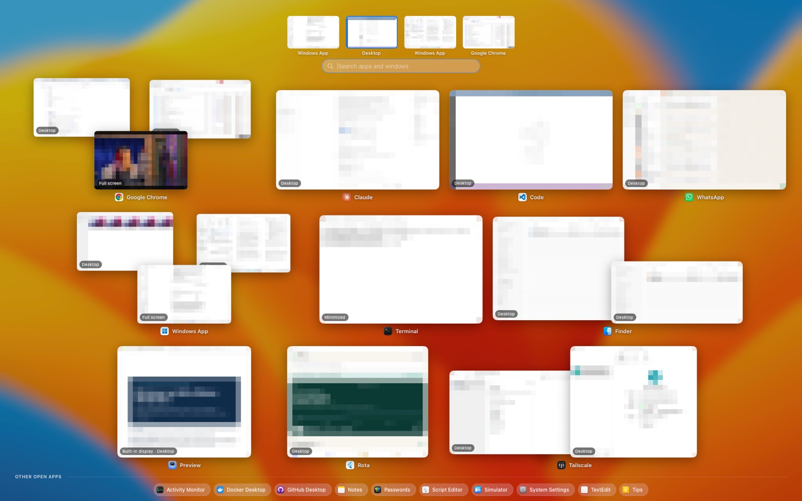
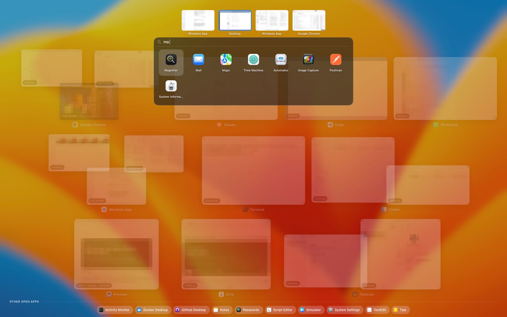
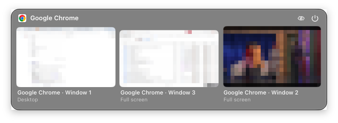
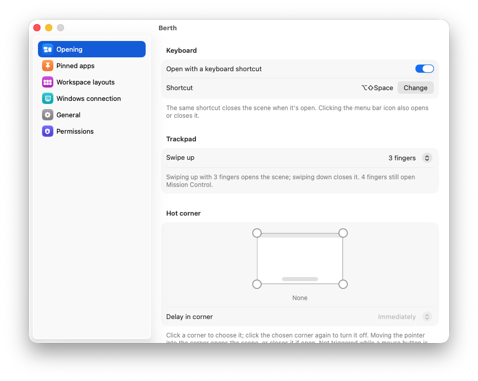
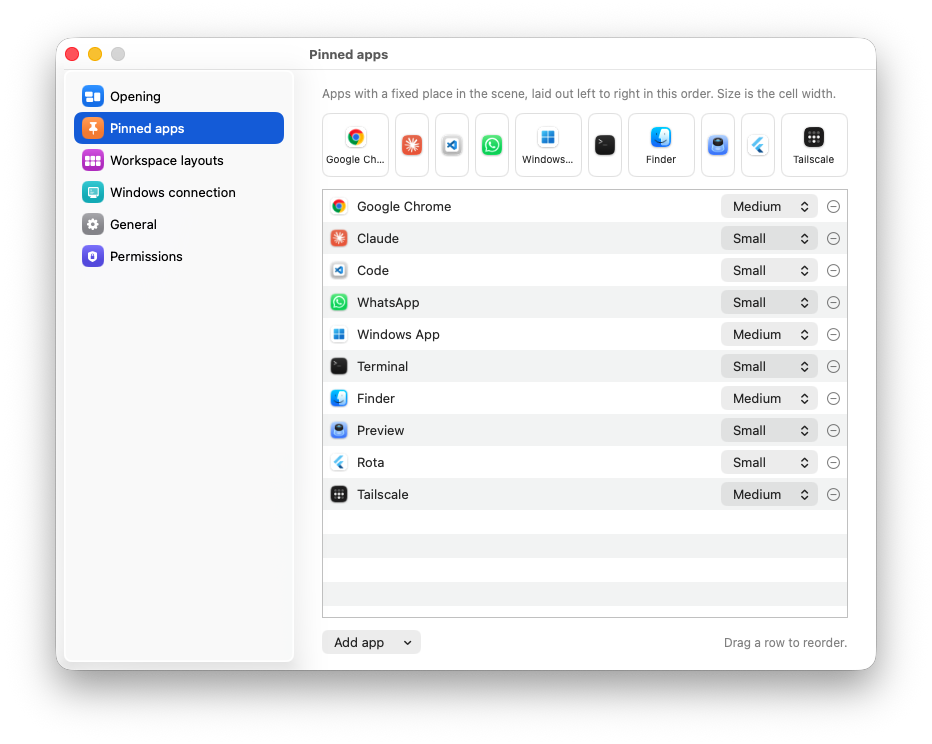
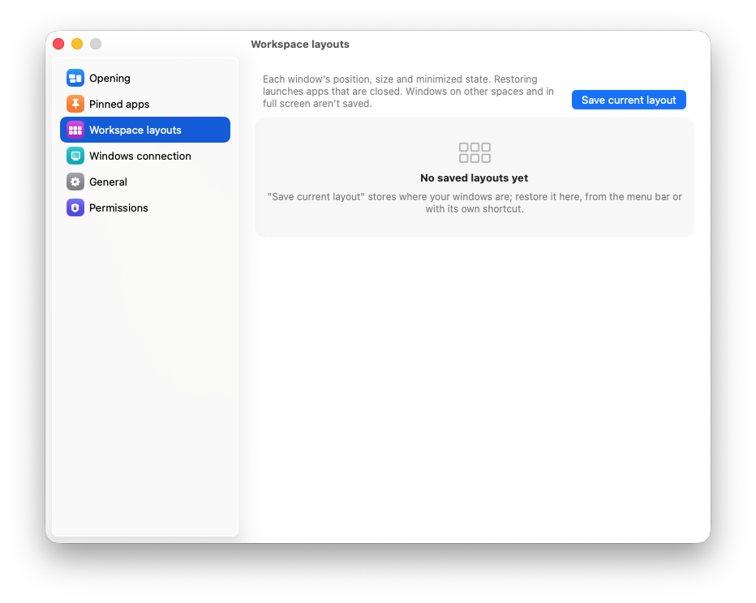
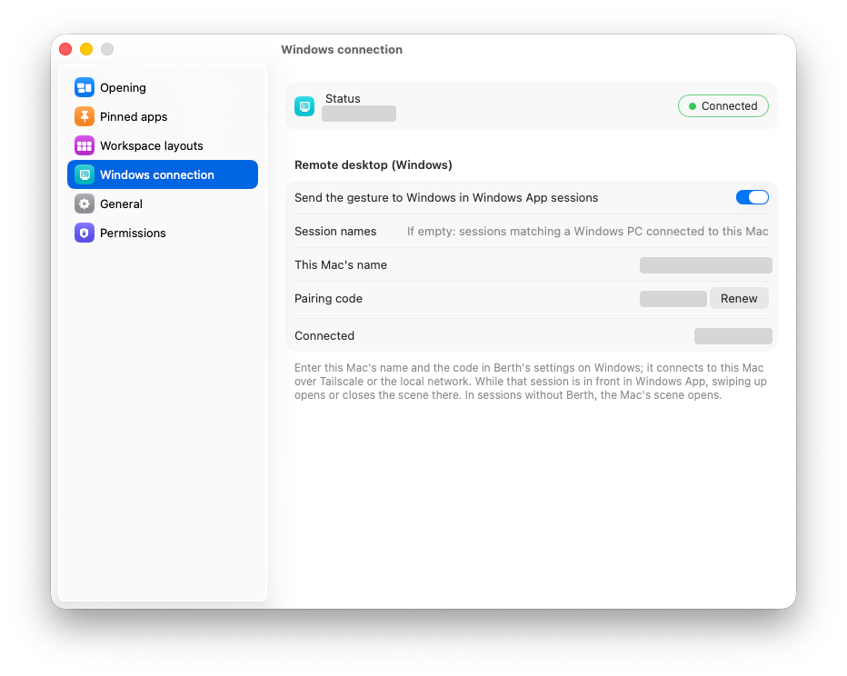
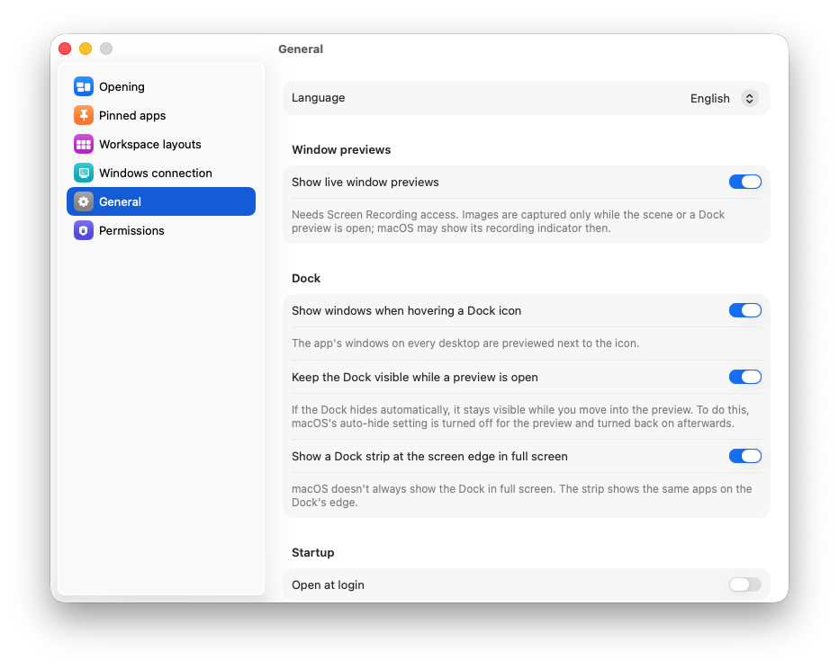
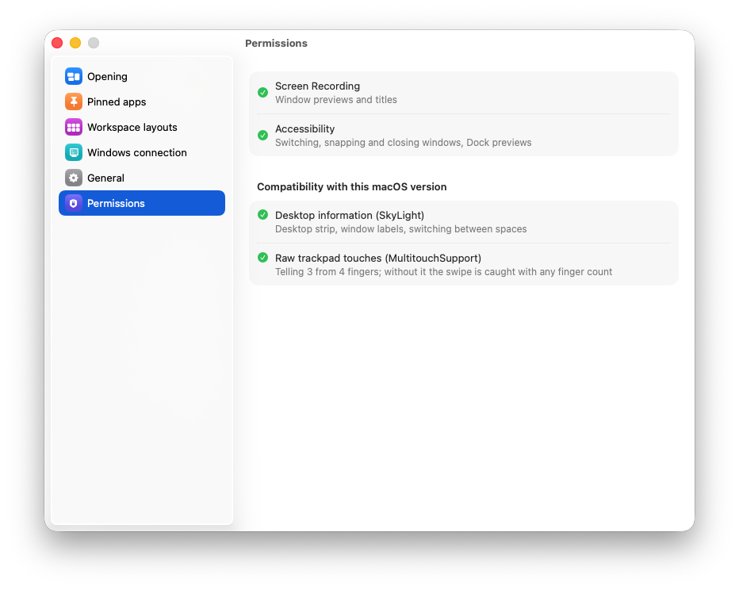

# Berth

**macOS ve Windows için pencerelerin ve sanal masaüstlerinin sabit yerleşimli genel görünümü.**

Mission Control ve Görev Görünümü her açılışta her şeyi yeniden dizer. Berth dizmez: her uygulamanın kendi yeri, yani *rıhtımı* vardır. Pencereleri canlı önizlemeleriyle hep orada görünür. Bir pencereyi aramadan, yerinden bulursun.

Ücretsiz ve açık kaynak (GPL-3.0). [English](README.md)



## Özellikler

- **Sabit yerler.** Uygulamaları hücrelere sabitlersin (küçük, orta, büyük); yerleşim her açılışta aynıdır. Sabitlenmemiş uygulamalar altta bir sırada durur.
- **Tüm masaüstleri bir arada.** Her sanal masaüstündeki ve tam ekrandaki pencereler, üstte masaüstü şeridiyle.
- **Arama.** Yazmaya başlayınca pencereler süzülür. Adı uyan uygulamalar, açık olmayanlar da dahil, arama kutusunun altında simge ızgarası olarak çıkar. Enter en iyi eşleşmeyi açar.
- **Klavye.** Oklar önizlemeler arasında gezer, Enter geçer, ⌘1…9 / Ctrl+1…9 o masaüstüne gider.
- **Önizlemede pencere eylemleri.** Sola ya da sağa yasla, ekranı kapla, küçült, kapat; macOS'ta diğer ekrana taşı.
- **Çalışma düzenleri.** Her pencerenin yerini (masaüstü, konum, boyut) kaydet, sonra kendi kısayoluyla geri yükle. Kapalı uygulamalar senin için açılır.
- **Açmanın birçok yolu.** Klavye kısayolu, sıcak köşe, menü çubuğu ya da tepsi simgesi, Mac trackpad'inde üç ya da dört parmakla kaydırma.
- **Dock ve görev çubuğu önizlemeleri.** Bir simgenin üstüne gelince o uygulamanın tüm masaüstlerindeki pencereleri görünür.
- **Mac ↔ Windows köprüsü.** Microsoft'un Windows App'i (Uzak Masaüstü) ile bir Windows bilgisayara bağlıyken Mac trackpad'inde yukarı kaydırmak, o bilgisayardaki Berth'i açar.
- **Gizlilik.** Hesap yok, analiz yok. Mac–Windows köprüsünü açmadıkça ağ bağlantısı da yok. Bkz. [gizlilik](store/privacy.md).

<table><tr>
<td width="62%"></td>
<td></td>
</tr></table>

<details>
<summary>Daha fazla görüntü: ayarlar</summary>

| | |
|---|---|
|  |  |
|  |  |
|  |  |

</details>

## Gereksinimler

| | macOS | Windows |
|---|---|---|
| Sürüm | macOS 14 ve sonrası | Windows 11 |
| İzinler | Erişilebilirlik (pencereye geçme, taşıma); Ekran Kaydı isteğe bağlı (canlı önizlemeler) | yok |
| Arayüz | Türkçe ve İngilizce | Türkçe ve İngilizce |

## Kurulum

İmzalı indirmeler [Releases](https://github.com/brkhsdmr/berth/releases) sayfasında, Windows sürümü Microsoft Store'da olacak. O zamana kadar kaynaktan derlenir.

### macOS

```bash
./Scripts/make-app.sh release    # derler, Apple Development kimliğinle imzalar, /Applications'a kurar
swift test                       # çekirdek yerleşim testleri
```

⌥⇧Space ya da menü çubuğu simgesiyle açılır.

### Windows

Visual Studio 2022 ya da sonrası, "Desktop development with C++" iş yüküyle (Build Tools yeterli).

```powershell
windows\scripts\build.ps1 Release
windows\scripts\install.ps1
```

Alt+Shift+Space ya da tepsi simgesiyle açılır.

## Nasıl çalışır

Berth iki platformda da yerel: macOS'ta Swift ve AppKit ile Core Animation, Windows'ta C++ ve Win32 ile Direct2D ve DWM önizlemeleri. Yerleşim kuralları (hücre yerleşimi, yığınlar, arama sıralaması, düzen eşleştirme), iki tarafta da birim testleri olan platformdan bağımsız bir çekirdekte durur: `Sources/BerthCore` ve `windows/src/core`.

Berth'in yaptıklarının bir kısmının resmi bir arayüzü yok; belgelenmemiş sistem arayüzlerine dayanıyor. Bunlar ayrı tutulur, çalışma anında aranır ve bozulursa sessizce devre dışı kalır:

- **macOS:** alanların listesi ve hangi pencerenin nerede olduğu için SkyLight, üç parmağı dört parmaktan ayırmak için MultitouchSupport. Bir güncelleme bunları kaldırırsa masaüstü şeridi ya da parmak ayrımı çalışmaz, uygulamanın geri kalanı çalışır. Ayarlar > İzinler bir uyumluluk denetimi gösterir.
- **Windows:** iç sanal masaüstü arayüzü (`IVirtualDesktopManagerInternal`); kimlikleri Windows sürümleri arasında değişir.

Her kararın arkasındaki ölçümlerle mühendislik notları [docs/mac-notes.md](docs/mac-notes.md) ve [docs/windows-notes.md](docs/windows-notes.md) dosyalarında. Sürüm çıkarma adımları [docs/distribution.md](docs/distribution.md) dosyasında.

## Hakkında

[Burak Hasdemir](https://github.com/brkhsdmr) tarafından geliştirildi. Berth'i ben tasarladım ve yönettim; kodu, Anthropic'in yapay zekâ kodlama yardımcısı [Claude](https://claude.com/claude-code) ile yazdık. Fikirlerin, ölçümlerin ve gerçek makinelerde yapılan denemelerin uzun bir alışverişiyle ortaya çıktı.

Hata bildirimleri ve katkılar memnuniyetle karşılanır.

## Lisans

[GPL-3.0](LICENSE). Berth'i kullanmakta, incelemekte, değiştirmekte ve paylaşmakta özgürsün; değiştirilmiş bir sürümü dağıtırsan kaynağı aynı lisansla açık kalmalı.

"Mission Control", Apple Inc.'in markasıdır. Berth'in Apple ya da Microsoft ile bir bağlantısı yoktur.
